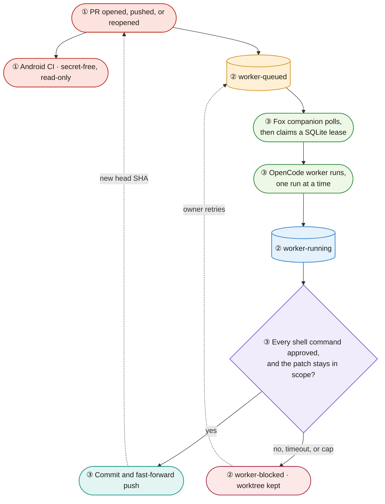

# GitKeeper

A local-first companion that runs the pull-request review relay between a reviewer
(Claude, pasted by the owner) and worker agents (OpenCode, Copilot): it prepares review
packets, carries requested changes back to the worker, asks the owner to merge, and keeps
no hand-written status. The product scope is in [`docs/PRD.md`](docs/PRD.md).

> **Re-scoped 2026-11-26.** The review relay in the PRD is now the primary goal; CI-failure
> repair is a secondary trigger. The queue and worktree plans under `docs/superpowers/plans/`
> are paused until `docs/TECHNICAL.md` says what is kept. Worker execution stays disabled.

> **Status: pre-alpha, not safe to launch workers yet.**
> The design contract, the desktop UI foundation, typed host-mode readiness, the
> local model ladder, the patch-scope gate, the one-shot command approval broker,
> and OpenCode command mediation are implemented and tested. Queue domain
> contracts and SQLite queue persistence are implemented, but GitHub
> reconciliation and the worktree lifecycle are **not** implemented, so worker
> execution stays disabled on purpose. Slice 1 is merged from
> [PR #15](https://github.com/SumukhaK/GitKeeper/pull/15) at
> `29ba84e390ef53d9fe9dc1fd30d74a811c8b9f47`; Slice 2 SQLite queue/cycle/lease
> persistence is merged from [PR #16](https://github.com/SumukhaK/GitKeeper/pull/16)
> at `9318e450823c17b1b2a2c2ca428e861c0a9bc8d6` after independent review; Slice 3
> operational-only telemetry is merged from
> [PR #27](https://github.com/SumukhaK/GitKeeper/pull/27) at
> `3f536c2c1ee7e7e571e4cfa283c82249959c9f55`. The
> atomic PR/commit guidelines are merged from
> [PR #17](https://github.com/SumukhaK/GitKeeper/pull/17) at
> `341baea33ffce36a49e6e65d90a3d8719bd18127`.

## What works today

| Area | State |
| --- | --- |
| Design spec and decisions | Complete — [`docs/superpowers/specs/`](docs/superpowers/specs/2026-11-20-gitkeeper-setu-mobile-pilot-design.md) |
| Atomic PR/commit guidelines | Merged in [PR #17](https://github.com/SumukhaK/GitKeeper/pull/17) — [`.github/copilot-instructions.md`](.github/copilot-instructions.md) |
| Handover tracker | Complete — [`docs/superpowers/plans/2026-11-20-gitkeeper-pilot-handover.md`](docs/superpowers/plans/2026-11-20-gitkeeper-pilot-handover.md) |
| Companion UI (fox pet, handscroll, queue/status/settings/telemetry pages) | Built against fakes, integration pending |
| Host-mode readiness policy | Complete (`src/gitkeeper/host_mode/readiness.py`) — typed `ACCEPTED_HOST_MODE` gate, launch blocked |
| Local model ladder and quota classification | Complete (`src/gitkeeper/policy/models.py`) |
| Patch-scope publication rule | Complete (`src/gitkeeper/policy/patch_scope.py`) |
| One-shot command approval broker | Complete (`src/gitkeeper/host_mode/command_broker.py`) — shows every request line, approves once, denies by default |
| Approval overlay in the handscroll | Built and tested against the real view model (`src/gitkeeper/ui/qml/CommandApprovalDialog.qml`) |
| OpenCode command mediation | Proven for CLI `1.19.6` (`src/gitkeeper/host_mode/opencode_capability.py`, `broker_plugin/`) — see [`host-mode-command-broker-result.md`](docs/superpowers/host-mode-command-broker-result.md) |
| Queue persistence and GitHub reconciliation | [Executable plan](docs/superpowers/plans/2026-11-25-gitkeeper-queue-persistence-reconciliation.md) — planning PR [#14](https://github.com/SumukhaK/GitKeeper/pull/14) merged; Slice 1 merged in PR [#15](https://github.com/SumukhaK/GitKeeper/pull/15); Slice 2 merged in PR [#16](https://github.com/SumukhaK/GitKeeper/pull/16); Slice 3 telemetry merged in PR [#27](https://github.com/SumukhaK/GitKeeper/pull/27); slices 4–7 pending |
| Queue, leases, GitHub label reconciliation, worktrees | Domain contracts and SQLite persistence/lease/cycle/attempt storage merged in PR [#16](https://github.com/SumukhaK/GitKeeper/pull/16); preserved worktree core (3A: contracts, external registry, path-fenced manager) merged in PR [#20](https://github.com/SumukhaK/GitKeeper/pull/20) at `921089e0b6b5008b32c85c6419d9adf33dd74a54`; trusted Git worktree transport (3B: canonical clone URL, external bare cache, isolated Git subprocesses) merged in PR [#22](https://github.com/SumukhaK/GitKeeper/pull/22) at `4d5cdc675be204d39ceedf2480d36e43eb12cac1`; 3C feedback core (queue-neutral feedback port, owner-only DACL, restricted SQLite store) merged in PR [#24](https://github.com/SumukhaK/GitKeeper/pull/24) at `e9c4eaab33878cce479e4874a941f86f8b9ac221`, with queue feedback/cancellation hooks deferred until queue Slice 5; 4A queue-independent executor gate (fail-closed `ExecutionGate`, typed job/result contracts, deterministic one-line prompt, exact model/SHA/readiness checks) merged in PR [#26](https://github.com/SumukhaK/GitKeeper/pull/26) at `dfff4a5449d92dced07e71339a2ba4d95040f87a`; 4B-1 fenced Windows process adapter (suspended create, kill-on-close Job Object, bounded output, exact-key registry) merged in PR [#29](https://github.com/SumukhaK/GitKeeper/pull/29) at `c4342ea92c453cd79fd649feceaae9980cd766c4`; 4B-2 loopback broker bridge (owner-only token file, exact plugin request validation, bounded body/handlers, one-shot approval handoff) merged in PR [#33](https://github.com/SumukhaK/GitKeeper/pull/33) at `4a55de0b8211c25d2842414c9baeea29f5a284ee`; 4B-3 gated OpenCode executor (gate/model/readiness/inert/SHA/args/env/Windows limits, loopback bridge + real broker, approval-before-start, typed failure results) merged in PR [#36](https://github.com/SumukhaK/GitKeeper/pull/36) at `8d68e9a42ff6c581f8279febe2705b450a2fc93e`, completing 4B (4B-1/2/3); 4C-1 Git publication operations (stage, fixed-identity commit, ancestry/count, fast-forward-only push, remote head) merged in PR [#42](https://github.com/SumukhaK/GitKeeper/pull/42) at `46ebef73ce8079c2d9b1ca95202653af3f88807d`; 4C-2 scoped diff extraction + authoritative publish target (fork-head scope rejection, `PublishTarget`/`PublishResult`, `GitHubPublishTargetAdapter`) merged in PR [#45](https://github.com/SumukhaK/GitKeeper/pull/45) at `60399f16191089eef1006f771b8d43304b931689`; 4C-3 fast-forward PatchPublisher (scope/staged/committed validation, one commit, intent before push, unknown association, read-only reconciliation) merged in PR [#48](https://github.com/SumukhaK/GitKeeper/pull/48) at `b41c3962ed53d3303eafcf42672d5e9fff27ed5e`, completing 4C (4C-1/2/3); 4D coordinator/lifecycle next; `block_reserved` and queue hooks wait for queue Slice 5; GitHub reconciliation not implemented |
| Worker wiring (real executor, worktree lifecycle, service integration) | [Detailed plan](docs/superpowers/plans/2026-11-25-gitkeeper-worktree-runner-service.md) for source-plan Tasks 3–5 — merged plan; 3A preserved worktree core, 3B trusted Git transport, 3C feedback core, 4A fail-closed executor gate, complete 4B (process adapter, loopback broker bridge, gated executor), and complete 4C (Git publication operations, scoped diff + publish target, fast-forward publisher) merged in PRs [#20](https://github.com/SumukhaK/GitKeeper/pull/20)/[#22](https://github.com/SumukhaK/GitKeeper/pull/22)/[#24](https://github.com/SumukhaK/GitKeeper/pull/24)/[#26](https://github.com/SumukhaK/GitKeeper/pull/26)/[#29](https://github.com/SumukhaK/GitKeeper/pull/29)/[#33](https://github.com/SumukhaK/GitKeeper/pull/33)/[#36](https://github.com/SumukhaK/GitKeeper/pull/36)/[#42](https://github.com/SumukhaK/GitKeeper/pull/42)/[#45](https://github.com/SumukhaK/GitKeeper/pull/45)/[#48](https://github.com/SumukhaK/GitKeeper/pull/48); 4D coordinator/lifecycle next; queue service hooks and `block_reserved` wait for queue Slice 5 |

## Queue implementation status

The active scope is the [queue persistence and reconciliation plan](docs/superpowers/plans/2026-11-25-gitkeeper-queue-persistence-reconciliation.md). Planning PR [#14](https://github.com/SumukhaK/GitKeeper/pull/14) is merged at `45a16255e694c372f1b970ad532a72d352c8d3a0` after seven independent review rounds and approval of `e836ab513b2cab5a74ec4f1508045d9efbb1b6b8`. Slice 1 (domain contracts and readiness-reason adapter) is implemented at `6be6122`, with the reviewed telemetry projection corrected at `f44ed8b`; 199 queue tests, 236 combined queue/readiness tests, and 564 full-suite tests pass. It passed scoped independent re-review and merged from PR [#15](https://github.com/SumukhaK/GitKeeper/pull/15) at `29ba84e390ef53d9fe9dc1fd30d74a811c8b9f47`. Slice 2 adds SQLite queue/cycle/lease persistence, attempts, manual retry latches, publication intents, and projection fences; it passed two independent fix rounds and merged from PR [#16](https://github.com/SumukhaK/GitKeeper/pull/16) at `9318e450823c17b1b2a2c2ca428e861c0a9bc8d6` with 264 focused and 629 full-suite tests passing. Slice 3 adds a separate path-fenced operational telemetry database with 90-day retention and no raw payloads; it passed one independent fix round and merged from PR [#27](https://github.com/SumukhaK/GitKeeper/pull/27) at `3f536c2c1ee7e7e571e4cfa283c82249959c9f55` with 89 focused and 786 full-suite tests passing. Slices 1–3 fulfill original Task 1 and slices 4–7 fulfill original Task 2. Source-plan Tasks 3–5 have a separate merged [worktree, runner, and service plan](docs/superpowers/plans/2026-11-25-gitkeeper-worktree-runner-service.md) for later handoff; neither plan authorizes worker enablement.

| Slice | Scope | Status | PR | Merge commit |
| --- | --- | --- | --- | --- |
| P0 | Publish plan, status tracking, and README/handover correction | merged | [#14](https://github.com/SumukhaK/GitKeeper/pull/14) | `45a16255e694c372f1b970ad532a72d352c8d3a0` |
| 1 | Domain contracts and readiness-reason adapter | merged | [#15](https://github.com/SumukhaK/GitKeeper/pull/15) | `29ba84e390ef53d9fe9dc1fd30d74a811c8b9f47` |
| 2 | SQLite queue/cycle/lease persistence | merged after independent review; 264 focused + 629 full-suite tests pass | [#16](https://github.com/SumukhaK/GitKeeper/pull/16) | `9318e450823c17b1b2a2c2ca428e861c0a9bc8d6` |
| 3 | Operational-only telemetry persistence | merged after independent review; 89 focused + 786 full-suite tests pass | [#27](https://github.com/SumukhaK/GitKeeper/pull/27) | `3f536c2c1ee7e7e571e4cfa283c82249959c9f55` |
| 4 | GitHub read/config/label REST adapter | pending | — | — |
| 5 | Queue service and label/budget transitions | pending | — | — |
| 6 | Restart/close/reopen reconciliation | pending | — | — |
| 7 | Adaptive outbound poller | pending | — | — |

## Quick start

Requirements: Python 3.10+, and for the desktop app PySide6 plus `pytest-qt`.

```powershell
py -m pip install -e ".[test]"
py -m pytest -q
```

For the desktop UI dependencies:

```powershell
py -m pip install -e ".[test,ui]"
```

`gitkeeper.ui.app:main` takes a queue service, so there is no console entry point
yet — the real queue service does not exist, and both it and the config publisher
are faked in `tests/fakes/`. Until then the window is exercised through the Qt
test suite: `py -m pytest tests/ui -q`.

## Commands

| Command | What it does |
| --- | --- |
| `py -m pytest -q` | Full suite (796 tests as of merge commit `824925f`) |
| `py -m pytest tests/test_queue_models.py tests/host_mode/test_readiness.py -q` | Queue domain contracts and readiness regressions (221 tests) |
| `py -m pytest tests/test_queue_models.py tests/test_queue_store.py -q` | Queue domain and SQLite persistence contracts (264 tests) |
| `py -m pytest tests/test_queue_telemetry.py -q` | Operational telemetry store (89 tests) |
| `py -m pytest tests/host_mode -q` | Typed readiness blockers, the approval broker, and OpenCode mediation |
| `py -m pytest tests/policy -q` | Model ladder, patch scope, manifest capability |
| `py -m pytest tests/ui -q` | View models and QML accessibility checks |

There is no lint config in the repository yet; keep the existing style
(frozen dataclasses, `__post_init__` validation, module-level pure predicates).

## How it is meant to work

Every box is tagged with the zone it lives in: **①** the public repository, **②** the
GitHub label that *is* the queue, **③** this machine. Colour carries meaning too —
pale rose is the untrusted public surface, amber is waiting, blue is in progress,
green is local work, lavender is a decision only the owner can make, teal is a
published change, and the deeper red is a PR that stopped and needs a human.



Read it as one loop. A public PR is queued by a label; this machine claims that head
SHA; every shell command needs a fresh approval; only an in-scope change is pushed
back, which starts the loop again at a new head SHA. Anything else parks the PR in
② `worker-blocked` with the worktree kept, and only an owner retry restarts it.

- **GitHub is authoritative** for PR and queue state; local SQLite only records
  local execution and recovery.
- **Remote queue state is a label**, not a database: `gitkeeper/worker-queued`,
  `gitkeeper/worker-running`, `gitkeeper/worker-blocked`.
- **Claiming** is a SQLite lease keyed by repository, PR number, and head SHA, so
  a new push makes the old claim stale instead of racing it.
- **Budgeting**: at most three automatic invocations per PR across head-SHA
  changes. On the cap the PR is blocked and only an explicit owner retry resumes.
- **Trust boundary**: PR code is untrusted. Public CI is secret-free and
  read-only on `pull_request`; only PRs authored by the owner are worker
  eligible. GitKeeper never accepts credentials from a repository config PR.

### The four code-enforced gates

`gitkeeper.host_mode.readiness` — the launch gate:

- `ACCEPTED_HOST_MODE` is a risk decision, not isolation, and never yields
  readiness on its own.
- Every refusal is named: allowlist, privacy, fork head, author, open/draft,
  merged config, repair reason, stale check SHA, attempt budget, model ladder,
  CLI version, and unproven command broker.
- Readiness is computed from explicit GitHub and local facts; there is no
  boolean bypass, and historical isolation reports cannot authorize a launch.

`gitkeeper.host_mode.command_broker` — the approval gate:

- One immutable request: executable, argv **or** a complete shell script,
  environment variable *names* only, absolute working directory, repository, PR,
  starting SHA, and a single-line purpose. There is no field for a secret, so the
  broker cannot leak or persist one.
- The digest is a SHA-256 over the canonical JSON of that request; any change to
  any field produces a different digest and voids the approval.
- A decision is one-use, unforgeable, time-limited (300 s), and only `approve`
  approves. A decision from another broker, a replay, a changed request, a moved
  PR head, or a fork head all refuse to execute.
- Remote facts are re-checked before presenting, after approval, and again at
  execution, so the owner is never asked to bless stale state.
- Execution itself is deliberately unimplemented: the only executor is
  `execution_disabled`, which raises. Task 3 proved that OpenCode mediation works;
  source-plan Task 4 is later, out-of-scope work that may wire an executor only
  after the queue slices land.

`gitkeeper.host_mode.opencode_capability` — the mediation contract:

- The CLI version, the *resolved* configuration (`permission.bash: "ask"`, the
  broker as the only plugin, no MCP servers) and a persisted live-probe record
  must all agree before `Broker` counts as verified; any gap keeps the launch
  blocked.
- The plugin entry is compared by module name, because `opencode debug config`
  reports absolute plugins as `file://` URLs.
- `require_inert_worktree` refuses a worktree containing `.opencode`, which the
  CLI scans for plugins outside the project-config guard; the launcher also clears
  `OPENCODE_PURE`/`OPENCODE_PERMISSION` and refuses `--auto`/`--pure`.
- `broker_plugin/gitkeeper-command-broker.mjs` is the hook itself: it forwards the
  exact command to the companion and throws unless the reply approves *that*
  request id. Deny, timeout, unreachable host, malformed reply, missing token and
  an unrecognised shell shape all block. Full evidence in
  [`host-mode-command-broker-result.md`](docs/superpowers/host-mode-command-broker-result.md).

`gitkeeper.policy.models` — the model ladder:

- Ordered, exact `opencode/` model IDs, default
  `opencode/deepseek-v4.1-flash-free`, then `glm-5.3`, `glm-5.3-flash`,
  `hy4-flash-free`, `deepseek-v4-pro`.
- Stored locally at `%LOCALAPPDATA%\GitKeeper\models.json`, never in a repository.
- Quota, rate-limit, or `429` output is classified `model-unavailable`: the
  worktree is preserved, the PR blocked, and the *next* entry suggested. Only the
  owner switches; the worker never auto-advances, and the invocation budget is
  untouched.

`gitkeeper.policy.patch_scope` — the publication gate:

- Checks in reporting order: worktree identity, structure, paths, manifest
  capability, intent, then publication order.
- Limits of 10 files, 400 changed lines, and 150 lines per file are code
  constants, so a repository config PR cannot widen its own blast radius.
- `AndroidManifest.xml` edits may only change values inside existing elements;
  permissions, features, components, and intent filters are frozen.
- Any violation keeps the worktree, blocks the PR, and waits for an explicit
  retry. Publication is fast-forward only and re-checks the remote head first.

## Repository layout

```
src/gitkeeper/
  host_mode/   typed ACCEPTED_HOST_MODE readiness blockers, approval broker, OpenCode mediation
  isolation/   historical Windows-probe evidence, not a launch gate
  policy/      model ladder, quota classification, patch-scope rule
  ui/          view models, services, and QML (fox pet + handscroll panel)
tests/         host_mode, policy, isolation, and UI suites plus fakes
docs/          design spec, plans, and the handover tracker
prototypes/    throwaway UI experiments, not shipped
brainstorm.md  historical design notes; non-authoritative
```

## Where to start as the next contributor

1. [`docs/PRD.md`](docs/PRD.md) — what GitKeeper does and does not do. This is the source of truth for scope.
2. The [design spec](docs/superpowers/specs/2026-11-20-gitkeeper-setu-mobile-pilot-design.md) — its trust and safety rules still apply until `docs/TECHNICAL.md` replaces them.
3. Open GitHub issues — the tracker. Do not start slices from the paused plans.

Worker execution must remain disabled.
